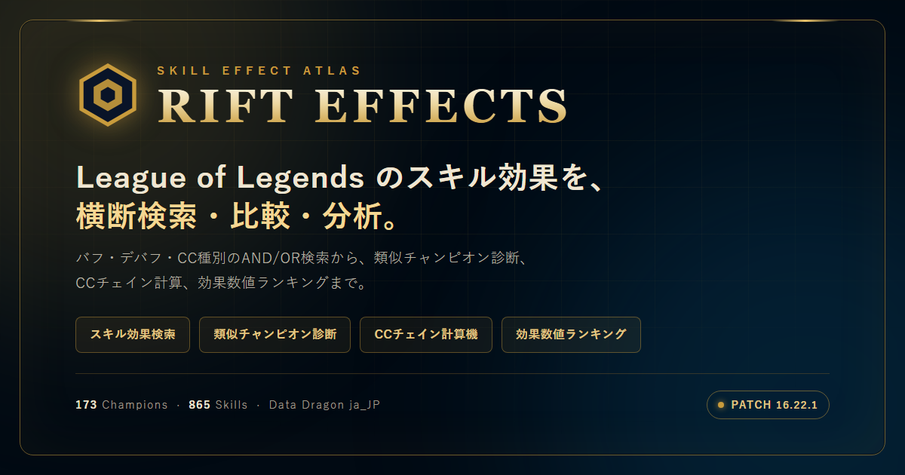

# RIFT EFFECTS



League of Legends（LoL）の全チャンピオン・スキル効果（バフ・デバフ・CC）に特化した、総合検索・分析 Web アプリケーションです。

Data Dragon（ja_JP）の日本語スキル名・説明・画像と、Meraki Analytics の構造化された CC / 発動タイプ / 効果時間データを組み合わせています。収録データは **173 チャンピオン / 865 スキル**（Data Dragon 16.22.1 時点）です。

## 🌐 公開URL

- 本番 URL: https://lol-sort.vercel.app
- リポジトリ: https://github.com/sirius-stakes/LoLSort

---

## 主な機能

### 1. スキル効果検索

全チャンピオンのスキルを、効果の種類とスキル属性から複合的に絞り込めます。

- **効果種別（バフ・デバフ・CC）**
  - ハードCC / ソフトCC / バフ / デバフのカテゴリを複数選択
  - **AND検索**（選択した種別をすべて含む）と **OR検索**（いずれかを含む）を切り替え
  - 各カテゴリの該当スキル数を表示
- **フリーワード検索**
  - チャンピオン名・チャンピオンキー・スキル名・説明文・ロール・効果ラベルを対象にリアルタイム検索
  - スキル説明文では、効果タグの言い換え（例: スロー / 移動速度低下）、ダメージ種別、数値をハイライト
- **スキルキー**: All / P / Q / W / E / R
- **発動タイプ**: 対象指定 / スキルショット / 範囲 / 自身
- **ダメージ属性**: 物理（AD） / 魔法（AP） / 確定（True） / ダメージなし（複数選択可）
- **レーン**: Top / Jungle / Mid / ADC / Support
- **戦術タイプ**: オールイン / ポーク / カウンター（チャンピオンのスキル構成から自動判定）
- **解除耐性**: クレンズ無効のみ / QSS必須のみ

検索結果のスキルカードには、チャンピオン・スキルのアイコン、スキルキー、発動タイプ、ダメージ属性、代表効果時間、クールダウン、効果タグ、所属レーン、戦術タイプを表示します。

初期表示は 30 件で、スクロール（IntersectionObserver）または「もっと見る」で追加読み込みします。デスクトップでは Sticky サイドバー、モバイルではフィルタードロワーで操作できます。

### 2. 類似チャンピオン診断

基準となるチャンピオンを 1 体選ぶと、スキル構成が近いチャンピオンを最大 5 体推薦します。

- レーン指定（全レーン / Top / Jungle / Mid / ADC / Support）を横断して候補を検索
- 類似度は以下を組み合わせて 100 点満点に換算
  - 共通するユニーク効果タグの重み付き一致度
  - Jaccard 係数（共通効果 / 全効果種類）
  - Q / W / E / R の効果カテゴリ配置ボーナス
  - 主力CCスキルの発動タイプ一致ボーナス
- スコア、共通効果、スキルキーごとの比較、操作感の共通点をカードで表示

### 3. CCチェイン計算機

最大 2 体のチャンピオンを選び、CC スキルを組み合わせた拘束時間を計算します。

- CC 効果を持つスキルを選択してチェインを構築
- 合計拘束時間とハードCC / ソフトCC の内訳を表示
- 0 秒から自動拡張されるタイムラインで、CC の連結を可視化
- クレンズ / QSS による解除可否を判定
  - ノックアップ・ノックバックなど、QSS でも解除できない CC を警告
  - サプレッションなど QSS が必要な CC を表示
- チャンピオンごとの代表 CC は「ハードCC優先・同カテゴリ内で効果時間が長いもの」を採用

### 4. 効果数値ランキング

全チャンピオン・全スキルを対象に、効果数値の比較ランキング（TOP10）を表示します。

- **最長ハードCC時間**: スタン・スネア・サプレッションなどの拘束秒数
- **最高スロー率**: 移動速度低下率（%）
- **防御低下（AR / MR削減）**: 物理防御・魔法防御を下げる効果
- **多機能チャンピオン（効果種類数）**: P/Q/W/E/R が持つユニークな効果タグの種類数

多機能チャンピオンランキングはチャンピオン単位で集計し、`effect.id` を基準に重複を排除します。種類数が同じ場合は、ハードCCの種類数が多いチャンピオンを上位に表示します。1〜3位はゴールド・シルバー・ブロンズの順位バッジ、4位以降は通常バッジで表示し、チャンピオンが持つ効果タグをカテゴリ別の色で一覧表示します。

### 5. 最新パッチノート閲覧ドロワー

ヘッダーの「最新パッチ」ボタンから、スライドインドロワーで最新パッチノートを確認できます。

- 開発 / プレビューサーバーでは `/api/patch-notes`（Vite プラグイン）が公式サイトの日本語パッチノート一覧を取得
- 最大 5 件の記事タイトル・公開日・概要・サムネイル・公式リンクを表示
- サーバー側で 30 分キャッシュ
- 静的ホスティング時は `src/data/patchNotes.json` のスナップショットと Data Dragon の最新バージョンにフォールバック
- 再読み込み、`Escape` での閉じる操作、フォーカストラップに対応

---

## 技術スタック

| 領域 | 採用 |
| --- | --- |
| UI | React 19 + React DOM |
| 言語 | TypeScript 7（strict） |
| ビルド / 開発サーバー | Vite 8 |
| スタイリング | Tailwind CSS 4（`@tailwindcss/vite`） |
| 状態管理 | React の `useState` / `useMemo` / `useCallback`（外部ライブラリなし） |
| アイコン | 独自 SVG コンポーネント（`src/components/Icons.tsx`） |
| チャンピオンデータ | Data Dragon（ja_JP） + Meraki Analytics から生成した JSON |
| パッチノート | 公式サイトのスクレイピング API（開発 / プレビュー） + 保存済みスナップショット |
| OGP | `index.html` のメタタグ + 静的 PNG（1200×630） |

Hextech 風のダークテーマ（背景 `#010A13` / `#091428`、アクセントゴールド `#C89B3C` / `#785A28`、テキスト `#F0E6D2`）で構成しています。

---

## セットアップ・開発手順

### 必要環境

- Node.js 24 以上を推奨
  - `npm run fetch:data` は TypeScript を Node.js のネイティブ型ストリッピングで直接実行します（Node.js 23.6 以上が必要）
- npm

### 1. クローンと依存パッケージのインストール

```bash
git clone https://github.com/sirius-stakes/LoLSort.git
cd LoLSort
npm install
```

### 2. 開発サーバーの起動

```bash
npm run dev
```

`http://localhost:5173` で起動します。

### 3. 本番ビルド

```bash
npm run build
npm run preview
```

`npm run build` は `tsc -b` による型チェックの後、`vite build` で `dist/` に出力します。

### 4. チャンピオンデータの取得・更新

```bash
npm run fetch:data
```

Data Dragon / Meraki Analytics から最新データを取得し、`src/data/champions.json` を再生成します。取得結果は `scripts/.cache/` にキャッシュされます。

### 5. パッチノートのスナップショット更新

```bash
npm run patches
```

公式サイトのパッチノート一覧から最新 5 件を取得し、`src/data/patchNotes.json` を更新します。静的ホスティング時のフォールバックデータとして使用されます。

### npm scripts

| コマンド | 内容 |
| --- | --- |
| `npm run dev` | 開発サーバーを起動（Vite） |
| `npm run build` | 型チェック + 本番ビルド |
| `npm run preview` | ビルド成果物をプレビュー |
| `npm run fetch:data` | 全チャンピオンデータを取得して `src/data/champions.json` を再生成 |
| `npm run data` | `fetch:data` と同じ（互換用エイリアス） |
| `npm run data:legacy` | 旧 `scripts/build-data.mjs` を実行（非推奨） |
| `npm run patches` | パッチノートのスナップショットを更新 |

---

## データ生成の仕組み

`npm run fetch:data` は `scripts/fetchChampionData.ts` を実行します。

1. **Data Dragon** から最新バージョンと `ja_JP` のチャンピオン詳細を取得
   - チャンピオン名 / タイトル / クラス / レーン / 画像
   - パッシブ・スキル名 / 説明 / 画像 / クールダウン
2. **Meraki Analytics** の `en-US` 構造化データを取得
   - CC 種別、発動タイプ、レベル別の効果時間
3. 英語効果文とレベル項目から、効果タグ・ダメージ属性・対象指定形式・クレンズ / QSS 可否を自動分類
4. 誤判定しやすい代表スキルは `CURATED` 系の定義で手動補正
5. `src/data/champions.json` に出力

分類の詳細:

- タグは Meraki の効果説明とレベル項目名から抽出（`notes` / `blurb` は文脈外の語を含むため除外）
- 「スキル名そのものに CC 名が含まれる」ケースを除外
- 「CC 無効」「～できない」など、効果を付与しない文脈を除外
- 効果時間は、Meraki のレベル別 `Duration` → 説明文の秒数 → 手動補正の順で決定
- 複数の効果がある場合は CC → バフの優先順で代表値を 1 つ採用
- 説明文は Data Dragon の日本語テキストを使用

自動分類のため、一部スキルでは実際の挙動とタグ・効果時間が完全一致しない場合があります。発見した場合は `scripts/fetchChampionData.ts` の `CURATED_REMOVE` / `CURATED_DURATIONS` などを調整して再生成してください。

---

## パッチノート取得の仕組み

- クライアントは `/api/patch-notes` を優先して取得
- Vite の開発 / プレビューサーバーでは `server/patchNotesApi.ts` が API を提供
- `server/patchNotes.ts` が公式サイトの `__NEXT_DATA__` からパッチノート記事を抽出（最大 5 件、30 分キャッシュ）
- API が利用できない静的ホスティングでは、`src/data/patchNotes.json` と Data Dragon の最新バージョンからフォールバックデータを生成

---

## OGP / サイトメタデータ

SNS（X / Discord など）で共有した際のカード表示に対応しています。

- `index.html` に以下のメタデータを設定
  - `description`
  - Open Graph: `og:type` / `og:site_name` / `og:title` / `og:description` / `og:url` / `og:locale` / `og:image`
  - Twitter / X: `twitter:card=summary_large_image` / `twitter:title` / `twitter:description` / `twitter:image`
- `public/og-image.png` に 1200×630 の OGP 画像を同梱
- `vite.config.ts` の `siteUrlPlugin()` が `%SITE_URL%` を解決
  - `VITE_SITE_URL` が設定されていれば最優先
  - Vercel では `VERCEL_PROJECT_PRODUCTION_URL` または `VERCEL_URL` から絶対 URL を自動生成
  - 未設定のローカル環境では相対パスのまま出力

独自ドメインで公開する場合は、Vercel の環境変数に `VITE_SITE_URL`（例: `https://example.com`）を設定してください。

---

## Vercel でのデプロイ

1. Vercel でリポジトリをインポート
2. Framework Preset: **Vite**
3. Build Command: `npm run build`
4. Output Directory: `dist`
5. 必要に応じて環境変数 `VITE_SITE_URL` を設定
6. デプロイ後、この README の「公開URL」に本番 URL を追記

静的ホスティングでは `/api/patch-notes` は動作しないため、パッチノートは保存済みスナップショット + Data Dragon のフォールバック表示になります。

---

## ディレクトリ構成

```text
.
├── index.html                     # OGP / サイトメタデータ
├── public/
│   ├── hex.svg                    # アプリロゴ
│   └── og-image.png               # OGP 画像（1200×630）
├── scripts/
│   ├── fetchChampionData.ts       # チャンピオンデータ取得・分類・JSON 生成
│   ├── fetch-patch-notes.mjs      # パッチノートスナップショット生成
│   └── build-data.mjs             # 旧データ生成スクリプト（非推奨）
├── server/
│   ├── patchNotes.ts              # 公式パッチノート取得・キャッシュ
│   └── patchNotesApi.ts           # /api/patch-notes（Vite プラグイン）
├── src/
│   ├── App.tsx                    # タブ / レイアウト / ページネーション
│   ├── main.tsx
│   ├── index.css                  # Tailwind テーマ・Hextech 背景
│   ├── components/
│   │   ├── CcChainCalculatorTab.tsx
│   │   ├── ChampionCombobox.tsx
│   │   ├── ChampionSimilarityTab.tsx
│   │   ├── EffectRankingTab.tsx
│   │   ├── PatchNotesDrawer.tsx
│   │   └── Icons.tsx
│   ├── features/
│   │   ├── skillSearch/
│   │   │   ├── FilterPanel.tsx
│   │   │   ├── Header.tsx
│   │   │   ├── SkillCard.tsx
│   │   │   ├── EffectBadge.tsx
│   │   │   ├── meta.ts
│   │   │   ├── format.ts
│   │   │   └── useSkillFilters.ts
│   │   └── championSimilarity/
│   │       └── SimilarityCard.tsx
│   ├── data/
│   │   ├── champions.json         # 生成済みチャンピオン・スキルデータ
│   │   ├── champions.ts           # データ参照用の型付きエクスポート
│   │   └── patchNotes.json        # パッチノートのフォールバック
│   ├── lib/
│   │   ├── highlight.tsx          # 説明文のキーワードハイライト
│   │   └── patchNotes.ts          # パッチノート取得・整形
│   ├── utils/
│   │   ├── championSimilarity.ts  # 類似度計算
│   │   ├── compositionClassifier.ts # 戦術タイプ判定
│   │   └── skillAnalysis.ts       # CC抽出・数値抽出・ランキング集計
│   └── types/
│       ├── champion.ts
│       └── skill.ts
├── package.json
├── vite.config.ts
└── tsconfig*.json
```

> `src/components/FilterPanel.tsx` / `SkillCard.tsx` / `Header.tsx` / `TagBadge.tsx` は旧タグ UI のコンポーネントで、現在のアプリからは参照されていません。`src/data/mockSkills.ts` も未使用です。`src/data/tags.ts` には旧ハイライト関数からの参照が残っていますが、現行の検索画面は `src/features/skillSearch/` 以下の実装を使用しています。

---

## 実装メモ

- 画像は Data Dragon の CDN URL を参照（バージョンは `champions.json` の `meta.version` に固定）
- データ JSON を同梱しているため、API がなくても検索・類似度・CCチェイン・ランキングは動作（画像は CDN 参照）
- 検索条件が変わると表示件数を 30 件にリセット
- モバイルのフィルタードロワーは `Escape` で閉じ、背景スクロールをロック
- `prefers-reduced-motion` を尊重
- 自動テストは未整備で、`npm run build` の型チェックとビルドで品質を担保

### 既知の制約

- バンドルサイズは約 1 MB（gzip 約 196 kB）。大半は 865 スキル分の日本語説明を含む JSON です。
- 効果時間は「スキルが持続する時間」ではなく、代表的な CC / バフの付与時間です。
- パッシブや形態変化など、説明文が複数効果を持つスキルは代表値のみ表示します。
- 効果タグ・効果時間は自動分類のため、実際のゲーム挙動と完全一致しない場合があります。
- 静的ホスティングではパッチノートのライブ取得 API が利用できません。

---

## 免責事項

RIFT EFFECTS は Riot Games 非公式のファンメイドツールです。League of Legends および関連する画像・テキストは Riot Games, Inc. の著作物です。

データ出典:

- [Data Dragon](https://developer.riotgames.com/docs/lol#data-dragon)（Riot Games）
- [Meraki Analytics](https://merakianalytics.com/)（コミュニティデータ）
